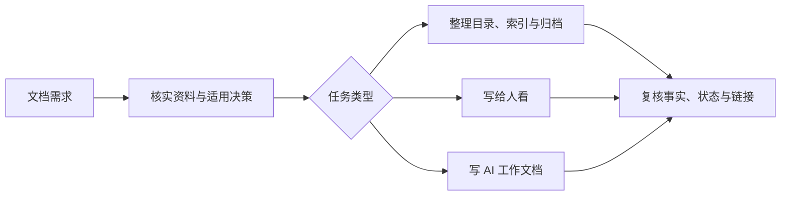

<p align="center">
  
</p>

<h1 align="center">Project Docs</h1>

<p align="center">
  用<strong>最少但够用的文档</strong>，让人看懂项目，让 AI 接上工作。
  <br>
  一个适用于 Codex 和 Claude Code 的轻量文档工作流。
</p>

<p align="center">
  <a href="#快速开始">快速开始</a> ·
  <a href="#工作流程">工作流程</a> ·
  <a href="./docs/README.md">文档索引</a> ·
  <a href="./LICENSE">MIT License</a>
</p>

---

## 它适合什么任务

| Skill | 适合的任务 |
| --- | --- |
| `project-docs` | 整理主题目录、明确权威来源、维护 `docs/README.md`、修复链接、归档工作材料 |
| `project-docs-human` | 编写和审阅人看的 README、教程、架构、设计、规格与项目状态 |
| `project-docs-agent` | 编写和审阅 AI 的执行计划、任务交接与工作记录 |

人类文档也供 AI 作为工作依据；协作不另建一套文档。按主题存放、按受众导航、按状态维护，同一事实只在一个权威位置维护。先核实资料，明确当前行为与已确认目标，再按实际需要整理或写作。

## 工作流程



这是一个包含三个提示词型 skill 的插件，由 Codex 或 Claude Code 在相关任务中使用，不会在后台自动扫描或修改仓库。详细规则见[英文共用文档约定](./skills/project-docs/references/conventions.md)，按任务选用见[使用指南](./docs/SKILL.zh-CN.md)。三个技能与共用约定均有[完整中文对照](./docs/SKILL.zh-CN.md#中文对照)，执行以英文为准。

## 快速开始

### Codex

Codex CLI：

```sh
codex plugin marketplace add Fengerss/project-docs-skill
codex plugin add project-docs@project-docs-marketplace
```

Codex 桌面版可在插件界面添加 GitHub 来源 `Fengerss/project-docs-skill`，再安装 **Project Docs**。

> Codex marketplace 当前通过 GitHub SSH 拉取插件源码；使用 SSH 安装需要本机已配置 GitHub SSH key。

### Claude Code

```sh
claude plugin marketplace add Fengerss/project-docs-skill
claude plugin install project-docs@project-docs-marketplace
```

安装后新开会话并直接描述文档任务。也可以显式调用所需技能。

Codex：

```text
$project-docs
$project-docs-human
$project-docs-agent
```

Claude Code：

```text
/project-docs:project-docs
/project-docs:project-docs-human
/project-docs:project-docs-agent
```

例如：“用 `project-docs-human` 对照代码和测试检查 README，只改已核实过时的内容。”

## 仓库内容

| 路径 | 用途 |
| --- | --- |
| `docs/README.md` | 文档总索引 |
| `skills/` | 三个技能入口及唯一维护的共用约定 |
| `docs/SKILL.zh-CN.md` | 面向人的技能使用指南 |
| `docs/skills/` | 三个技能与共用约定的中文对照稿 |
| `.agents/plugins/marketplace.json` | Codex 插件目录 |
| `.claude-plugin/` | Claude Code 插件及 marketplace 清单 |
| `tests/fixtures/docs-cleanup/` | 试用样例，含过时 README、被替代的未完成计划、AI 工作记录和 ADR |

## 本地验证

```sh
py -3 -m unittest discover -s tests -v
claude plugin validate --strict .
```

单元测试检查打包技能、版本一致性和本地 Markdown 链接；它们不能证明 AI 一定会正确执行。行为试用入口见[使用指南](./docs/SKILL.zh-CN.md#试用样例)。

## 许可

[MIT License](./LICENSE)
