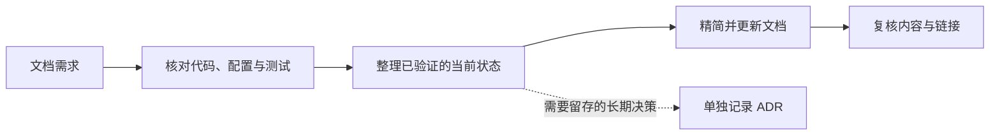

<p align="center">
  
</p>

<h1 align="center">Project Docs</h1>

<p align="center">
  让项目文档始终对齐<strong>已核实的代码现状</strong>。
  <br>
  一个适用于 Codex 和 Claude Code 的轻量文档工作流。
</p>

<p align="center">
  <a href="#快速开始">快速开始</a> ·
  <a href="#工作流程">工作流程</a> ·
  <a href="./LICENSE">MIT License</a>
</p>

---

## 它适合什么任务

- 新建或更新项目说明、README、架构与设计文档、规则和术语表。
- 对照源码、配置和测试检查现有文档，修正过时或重复的内容。
- 让当前状态文档聚焦“现在如何工作”；需要保留的长期决策另记为 ADR。

默认先核实资料再写作，优先让人快速看懂，并从最少够用的文档开始。

## 工作流程



这是一个提示词型 Skill：由 Codex 或 Claude Code 在相关任务中调用，不会在后台自动扫描或修改仓库。

## 快速开始

### Codex

Codex CLI：

```sh
codex plugin marketplace add Fengerss/project-docs-skill
codex plugin add project-docs@project-docs-marketplace
```

Codex 桌面版可在插件界面添加 GitHub 来源 `Fengerss/project-docs-skill`，再安装 **Project Docs**。

> Codex marketplace 当前通过 GitHub SSH 拉取插件源码；使用 SSH 安装需要本机已配置 GitHub SSH key。

### Claude Code

```sh
claude plugin marketplace add Fengerss/project-docs-skill
claude plugin install project-docs@project-docs-marketplace
```

安装后新开会话并直接描述文档任务。也可以显式调用：

```text
/project-docs:project-docs
```

例如：“请对照代码和测试检查 README，只改已核实过时的内容。”

## 仓库内容

| 路径 | 用途 |
| --- | --- |
| `skills/project-docs/SKILL.md` | Codex 与 Claude Code 共用的 Skill |
| `docs/SKILL.zh-CN.md` | Skill 中文阅读稿 |
| `.agents/plugins/marketplace.json` | Codex 插件目录 |
| `.claude-plugin/` | Claude Code 插件及 marketplace 清单 |
| `tests/fixtures/docs-cleanup/` | 文档清理试用样例，含过时 README 和 ADR |

## 本地验证

```sh
py -3 -m unittest discover -s tests -v
claude plugin validate --strict .
```

## 许可

[MIT License](./LICENSE)
